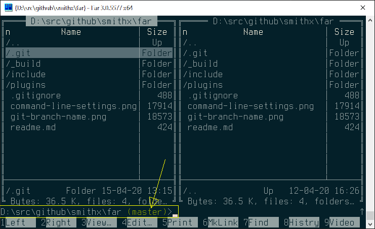

# GitBranch Far Manager plugin

Plugin helps Far Manager to show git branch at command prompt. It setups `%GITBRANCH%` to branch name for repository on active panel. You should customize "Command line settings" to insert `%GITBRANCH%` in command line prompt format string. Branch name will be shown at command prompt:

## Features

- Shows current git branch name in the command prompt
- Adds `!` suffix if there are uncommitted changes in the repository
- Shows short commit hash for detached HEAD state (e.g., `abc1234...`)
- Shows `HEAD (no branch)` for repositories without a branch

**Git is not needed** - plugin uses libgit2 library directly

